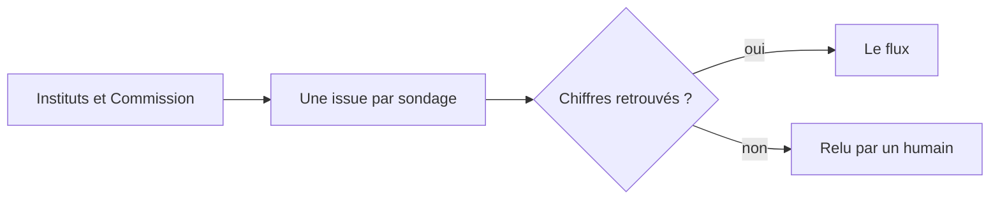

# rolling-2027

**Tous les sondages de la présidentielle 2027, dans l'heure, vérifiés chiffre par chiffre.**

Un flux ouvert, au format de [Mieux Voter](https://github.com/MieuxVoter/presidentielle2027), tenu à jour par des robots. Ils guettent la [Commission des sondages](https://www.commission-des-sondages.fr/) et les sites des instituts, lisent chaque nouveau sondage, et ne publient que ce qu'ils retrouvent mot pour mot dans le document source.

## Le flux

| | Adresse |
|---|---|
| **JSON** | `https://raw.githubusercontent.com/EnzoSim/rolling-2027/refs/heads/main/presidentielle2027.json` |
| JSON, miroir | `https://cdn.jsdelivr.net/gh/EnzoSim/rolling-2027@main/presidentielle2027.json` |
| CSV | [presidentielle2027.csv](presidentielle2027.csv) |

Premier et second tours, depuis juillet 2024. Un outil qui lit le flux de Mieux Voter lit celui-ci sans rien changer.

## Comment ça marche

- **Vite.** Les sites des instituts sont lus toutes les 20 minutes, le registre de la Commission toutes les heures : un rapport entre dans le flux dès sa publication, avant même sa notice.
- **Vérifié.** Chaque part est retrouvée sur sa ligne du document, chaque tableau fait 100 %, la vague du jour n'est jamais confondue avec son rappel, et une part très loin des autres sondages bloque la fusion.
- **Traçable.** Chaque ligne garde le nom de son document. Quand la notice arrive après le rapport, elle se rattache aux mêmes lignes, sans doublon.

Le détail : [docs/FONCTIONNEMENT.md](docs/FONCTIONNEMENT.md).

<b>Les listes les plus testées</b>

<!-- TOP_HYPOTHESES:START -->
| Rang | Sondages | Candidats (🥇) / Diff vs 🥇 (🥈🥉) |
|:----:|:--------:|----------------------------------|
| 🥇 | 27 | Bruno Retailleau, Fabien Roussel, Jean-Luc Mélenchon, Marine Le Pen, Marine Tondelier, Nathalie Arthaud, Nicolas Dupont-Aignan, Raphaël Glucksmann, Édouard Philippe, Éric Zemmour |
| 🥈 | 27 | $\textcolor{green}{\text{+ Gabriel Attal}}$, $\textcolor{red}{\text{− Édouard Philippe}}$ |
| 🥉 | 22 | $\textcolor{green}{\text{+ Gabriel Attal}}$ |

> 🥇 liste complète des candidats (référence). 🥈🥉 diff vs 🥇 : $\textcolor{green}{\text{+ ajouté}}$ en vert, $\textcolor{red}{\text{− retiré}}$ en rouge.
<!-- TOP_HYPOTHESES:END -->

## Contribuer

Pour ajouter un sondage à la main, suivre [COMMENT_AJOUTER_UN_SONDAGE.md](COMMENT_AJOUTER_UN_SONDAGE.md). Pour répondre sous les issues comme le bot, voir [docs/BOT.md](docs/BOT.md). Chaque PR est validée par les tests et `merge.py`.

## Crédits

Un fork de [MieuxVoter/presidentielle2027](https://github.com/MieuxVoter/presidentielle2027), dont il garde le format, les données et la méthode : merci à [Mieux Voter](https://mieuxvoter.fr), l'association qui défend le jugement majoritaire, et à ses contributeurs. **[Soutenir Mieux Voter](https://www.paypal.com/donate/?hosted_button_id=QD6U4D323WV4S)**.

Utilisé par [Ballottage](https://ballottage.com), un jeu gratuit de pronos sur la présidentielle 2027.

Licence MIT : © 2025 Mieux Voter, © 2026 Enzo Simier pour les modifications.
